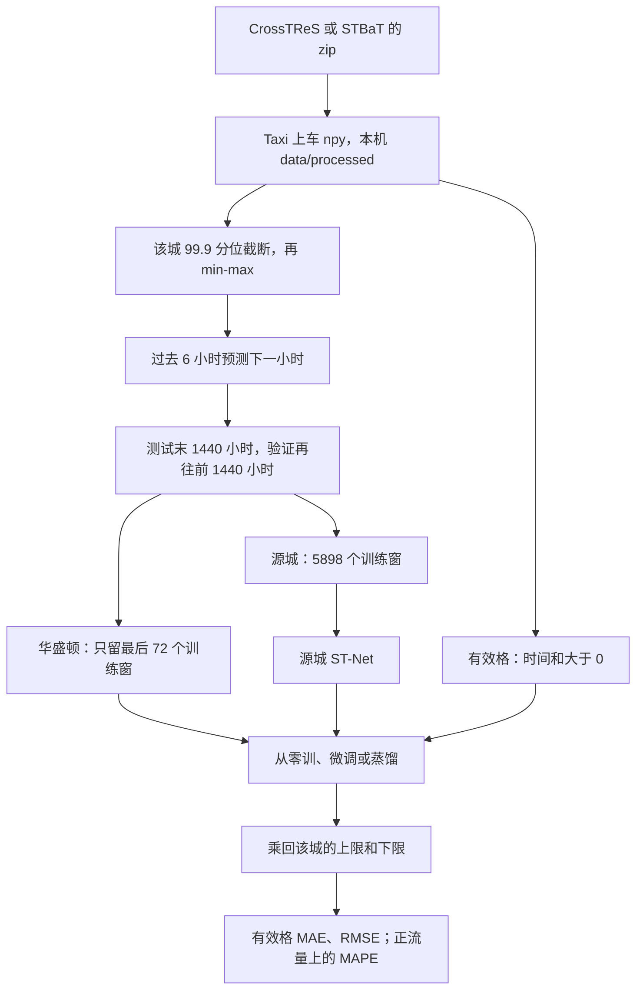
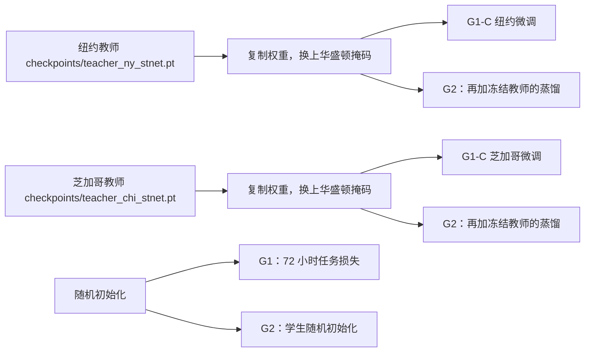
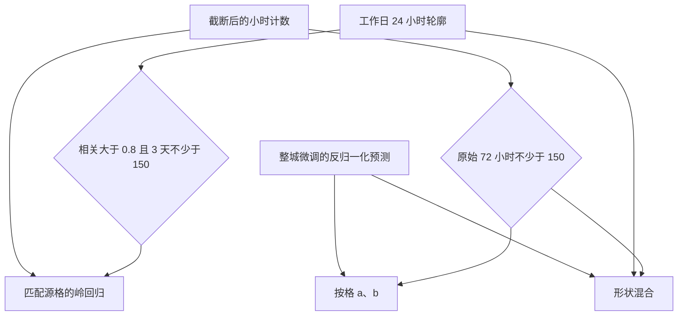

# 方法与数据流

日期：2026-11-16。这一页按当前仓库里的脚本和文档，把已经做完的方法串成一条管线。系统结构图在 [architecture.html](architecture.html)，用浏览器打开即可。指标的出处是 [RESULTS.md](RESULTS.md)、[CALENDAR_RESULTS.md](CALENDAR_RESULTS.md) 和 [profiles/](profiles/README.md)。和论文比相对下降见 [PAPER_COMPARISON.md](PAPER_COMPARISON.md)。匹配源格的归一化见 [profiles/matched_cell_normalization.md](profiles/matched_cell_normalization.md)。按格 \(a,b\) 的公式见 [profiles/cell_affine_explain.md](profiles/cell_affine_explain.md)。

[HANDOFF.md](HANDOFF.md) 后半仍是 2026-11-04 前后的交接，分组是否跑完以本页和 RESULTS 为准。Group 3 的工作日 Pearson 乘子还没有实现，这里只作为已批准、公式未定的后续记一笔。

## 1. 要预测什么

一座城被分成 1 km 网格，每小时一个上车数。输入是过去 6 小时，输出是下一小时。源城是纽约或芝加哥，目标城是华盛顿。目标城训练只有 3 天。骨干是 CrossTReS 的 ST-Net，带 BatchNorm，最后一层是 sigmoid。本仓库没有做 CrossTReS 的区域重加权，也没有做 STBaT 的区域不平衡模块。

通道在已跑的实验里是 `Taxi{CITY}_pickup.npy`。下车和单车没有进入这些 MAE。

## 2. 数据从哪进

上游包是 CrossTReS 的 `crosstres_data.zip`，或内容相同的 STBaT `data.zip`。直链、SHA256 和解压布局在 [DATA.md](DATA.md)。压缩包、`npy`、权重不进 git。本机放到 `data/raw/`，再映射到：

```text
data/processed/ny/upstream/TaxiNY_pickup.npy
data/processed/chi/upstream/TaxiCHI_pickup.npy
data/processed/dc/upstream/TaxiDC_pickup.npy
```

`load_city_array` 也会接受 `data/processed/{city}/flow.npy` 或 `data.npz` 里的 `flow`。读入后是 `T×H×W` 的 float。

| 城市 | 形状 | 网格 | 出租上车有效格 |
|---|---|---|---:|
| 纽约 | `(8784, 20, 23)` | 20×23 | 458 |
| 芝加哥 | `(8784, 17, 28)` | 17×28 | 270 |
| 华盛顿 | `(8784, 21, 20)` | 21×20 | 207 |

`T=8784=366×24`。第 0 小时记为 2016-01-01 00:00，不做夏令时插删。芝加哥和华盛顿与纽约一样长，轮廓日历共用这个起点。有效格的定义是该格在全部小时上的和大于 0，掩码在归一化之前从原始数组算出，训练、微调和评估共用这一张掩码。

## 3. 分城截断和 min-max

`min_max_normalize` 对一整座城的全部数值做一次，三座城各算各的：

1. 排序后取下标 `int(元素个数 × 0.999)` 作为上限。RESULTS 里这三座城的上限大约是纽约 1212、芝加哥 536、华盛顿 234。
2. 下限是 `max(0, 最小值)`。上车计数的下限是 0。
3. 大于上限的值截断到上限，减去下限，再除以上限减下限。

这一步用的是整段 8784 小时，验证集和测试集的小时也参与了上限和下限。这是 CrossTReS / STBaT 那套预处理的做法，切分发生在它之后。模型看到的是该城自己的尺度。归一化值 0.5 在下限为 0 时，大约是纽约 606、芝加哥 268、华盛顿 117 次上车，三座城的 0.5 不是同一个数量。

反归一化是评估和后处理用的：

\[
\text{上车量} = \text{网络输出}\times(\text{上限}-\text{下限})+\text{下限}.
\]

网络输出经过 sigmoid，落在 \((0,1)\)。

## 4. 训练、验证、测试怎么切

`split_x_y` 从小时 6 开始。每个样本的 \(x\) 是 \([t-6,t-1]\)，\(y\) 是小时 \(t\)。\(x\) 的形状是 `(N, 6, H, W)`，\(y\) 是 `(N, 1, H, W)`。

| 段 | 标签小时下标 | 长度 | 在实验里的角色 |
|---|---|---:|---|
| 测试 | `[7344, 8784)` | 1440 | 只评估一次 |
| 验证 | `[5904, 7344)` | 1440 | 早停 |
| 训练标签 | `[6, 5904)` | 5898 | 源城教师、以及目标城裁切之前的训练段 |
| 目标城 3 天 | `[5832, 5904)` | 72 | 2016-08-31 00:00 至 2016-09-02 23:00，三个工作日 |

源城教师 `few_shot_days=0`，而且 `concatenate_all_for_train=False`。CrossTReS 原文常把源城的训练、验证、测试拼回去预训练；本仓库的 Group 1 没有拼。源城只用 5898 个训练窗口，验证集用来早停。

目标城把训练窗口收成最后 72 个，也就是标签 `[5832, 5904)`。这 72 小时之前的 6 小时只作为第一个样本的输入，不作为标签。验证集和测试集仍各 1440 小时。

`few_shot_split_indices` 仍按 `30×24` 画示意图，正式实验走 `split_x_y` 的 `60×24`。



## 5. 模型和损失

ST-Net 与 CrossTReS `class STNet` 的前向一致：每个滞后小时过一层卷积和若干残差块，残差块是 BatchNorm、ReLU、卷积做两遍再加回输入。默认 64 通道、3 个残差块。各格子把 6 个滞后当成自己的序列，送进隐层 128 的 LSTM。最后的线性层加 sigmoid，再按空间掩码只保留有效格，输出 `(batch, 1, N_valid)`。

任务损失是有效格上的平方误差，先对 batch 取平均，再对格子求和，与 CrossTReS 的 `((out - y_valid) ** 2).mean(0).sum()` 相同。优化器一侧：batch 8，学习率 0.001，权重衰减 `5e-5`，最多 50 个 epoch。早停看验证集的归一化 RMSE，连续 5 个 epoch 没有更低就停。种子 42 是主结果，43 和 44 只重跑华盛顿设定，不重训源城教师。

MAE 和 RMSE 覆盖全部有效格，单位是反归一化后的每小时上车量。MAPE 只在反归一化后真实流量大于 0 的格子上计算，分母是该流量，结果乘 100。MAPE 和 MAE 回答的问题不同，对照时分开报。

## 6. 三条训练支路

权重只留在本机 `checkpoints/`。

| 代号 | 华盛顿上的初始权重 | 损失 | 源城教师 |
|---|---|---|---|
| G1-tgt-3d | 随机 | 只有任务损失 | 不用 |
| G1-C | 复制源城权重，去掉源城 `spatial_mask`，全部解冻 | 只有任务损失 | 不参与损失 |
| G2，随机初始化 | 随机 | `L_task + λ L_kd`，主实验 λ=1 | 冻结，和学生对同一批华盛顿归一化窗口 |
| G2，教师初始化 | 同样复制源城权重 | 仍是 `L_task + λ L_kd` | 另存一份并冻结 |

蒸馏项和任务损失用同一种归约：batch 上平均，格子上求和。教师前向在 `torch.no_grad()` 里，`train()` 时教师保持 `eval`。教师直接吃华盛顿的归一化窗口，不做区域匹配。`pearson_mask` 在这些配置里是空的。

芝加哥到华盛顿还扫过 λ=0.1、0.5、1、5，随机初始化和教师初始化都扫了。λ=1 沿用已有结果。扫描里测试 MAE 最低的一点是教师初始化、λ=0.1，它是看过测试集才知道最低的，主结论用预先指定的 λ=1。这个 λ 是训练损失的系数，和后文按格仿射的 λ=72 不是同一个数。



种子 42 的测试 MAE：从零训 1.8701，纽约微调 1.7153，芝加哥微调 1.4773，纽约随机蒸馏 1.7519，芝加哥随机蒸馏 1.7485。三种子均值里芝加哥微调 1.5171 仍然最低；纽约随机蒸馏的均值 1.9422，高于从零训的均值 1.8850。相对比例写在 [PAPER_COMPARISON.md](PAPER_COMPARISON.md)。

## 7. 轮廓、分档和门控

这些步骤不更新 ST-Net 的权重。轮廓脚本把原始上车按工作日、钟点求均值。工作日是周一到周五。`train_prefix` 是去掉验证和测试各 1440 小时之后的前 5904 小时，其中工作日 176 天。目标城的短轮廓是最后 3 个训练工作日，日期就是 2016-08-31 至 09-02。常数轮廓的 Pearson 记为无定义。

0.5 和 0.8 用来描述或路由，是事先定下的切点。相关大于 0.8 走该源城的纯微调，大于 0.5 且不超过 0.8 走该源城的随机初始化蒸馏，不超过 0.5 或无定义走华盛顿从零训练。纽约和芝加哥分开选，因为同一格对两座源城的相关不同。

在这个切点下重放已有预测：

- 不做 150 门时，按档拼接的测试 MAE 是纽约 1.7353、芝加哥 1.6309。纽约这一路相对纯微调 1.7153 更高。
- 三天上车合计不少于 150 才按档，没过门的格子仍用微调。过门格子 50 个。测试 MAE 是纽约 1.7132、芝加哥 1.4737，相对各自微调只低 0.12% 和 0.24%。种子 42 到 43，纽约微调本身从 1.7153 变到 1.6344。门控的变化落在种子波动里面，不能写成稳定的方法胜利。
- 把华盛顿短轮廓换成以该格为中心的 3×3 求和再分档，测试 MAE 高于一律微调。

兴趣点功能区用 CrossTReS 附录的 14 类做静态标签，切分在看误差之前定下。居住类按那个规则在华盛顿有效格上是 0 格。这是误差的分层描述，没有变成新的训练目标。

## 8. 三条后处理

三者都从已经训好的微调出发，数据流在微调的反归一化预测或原始计数之后才分叉。



**匹配源格。** 相关高于 0.8 且 3 天不少于 150，纽约源和芝加哥源各 46 格。源城 `[0, 5832)` 的截断计数先乘一个常数，使均值等于华盛顿该格 72 小时的均值，再学 6 小时滞后的形状，然后在 72 小时上拟合水平。验证集平均 MAE 严格低于同一批格子上的微调，才计算测试集。纽约打开了，测试集上微调仍低于匹配；芝加哥没有打开。缩放和「为什么分城归一化之后仍会看到差别」写在 [profiles/matched_cell_normalization.md](profiles/matched_cell_normalization.md)。

**按格仿射。** 过门的 50 格在 72 小时上拟合 \(p'=ap+b\)，λ=72 把 \(a\) 拉向 1、把 \(b\) 拉向 0。其余格子 \(a=1\)、\(b=0\)。\(a\) 没有裁到 \([0,1]\)。测试 MAE 纽约 1.7054、芝加哥 1.4415，相对微调低 0.58% 和 2.42%。公式和 λ 的量纲写在 [profiles/cell_affine_explain.md](profiles/cell_affine_explain.md)。

**形状混合。** 过门格子保留相关不低于 0.8、并且离最高相关不超过 0.02 的源城格子。这些长期轮廓先平均，再缩放到该格 3 天的日均上车量。预报是 \((1-w)\times\)微调 \(+ w\times\)形状。\(w\) 在验证集全城 MAE 上从 0 到 1、步长 0.05 选取。纽约 \(w=0.10\)，测试 MAE 1.7153，与微调的 MAE 相同，RMSE 略高。芝加哥 \(w=0.15\)，测试 MAE 1.4645，相对微调 1.4773 低 0.87%。这里的 \(w\) 是混合权重。按格仿射的 \(a\) 是乘数，蒸馏的 λ 是损失系数。

## 9. 日历侧的一条支路

[CALENDAR_RESULTS.md](CALENDAR_RESULTS.md) 换了训练标签，验证集和测试集的日历没换。华盛顿这一轮的标签是 2016-08-27、2016-08-28，以及 2016-08-31 至 09-02，共 120 小时。8 月 29 日和 30 日不作为标签。工作日模型去掉 2016 年列出的美国联邦假日；劳动节在验证集，下标 5952，评价时走周末模型。

分开训练的两个模型按标签小时的类别拼接。芝加哥分开微调后拼接的测试 MAE 是 1.4510，该协议下从零训是 1.7470。这个 1.7470 和连续 3 个工作日的 1.8701 不是同一次实验的基准，相对下降不放进主对照表。

## 10. 还没有做的部分

Group 3：冻结教师之后，用工作日 24 小时 Pearson 乘子去调制蒸馏损失。方向已经批准，乘子不可学习，公式没有定稿，`KDWrapper.pearson_mask` 仍是空钩子。0.5 和 0.8 继续只作为描述和路由的切点。这一页不实现它。

也还没有：把 CrossTReS 的区域重加权或 STBaT 的不平衡模块移植进来；在官方代码上复现论文表；在本机缺数据时导出逐格 \(a,b\) 或匹配源格的逐格残差。

## 11. 哪些在 git 里，哪些只在本机

| 在 git 里 | 只在本机，被 gitignore |
|---|---|
| `src/` 的模型、损失、划分、归一化 | `data/raw/**`、`data/processed/**` 里的数组 |
| `scripts/` 00–18 与测试 | `checkpoints/**`，含 `finetune_ny2dc.pt`、`finetune_chi2dc.pt` |
| `docs/RESULTS.md`、`docs/CALENDAR_RESULTS.md` | `logs/`、`runs/`、`outputs/` |
| `docs/profiles/*.md` 和汇总 JSON | `logs/bin_route_cache/*.npz` |
| 配置 YAML | `*.npy`、`*.npz`、`*.pt`、`*.pth`、`*.pdf` |

汇总 JSON 里有中位数、分位数和全城 MAE。逐格 \(a,b\)、逐格匹配残差、逐格缩放倍数没有入库。重跑匹配源格需要处理后数组和路由缓存；重跑按格仿射还需要两个微调权重。示意图不依赖这些文件。
