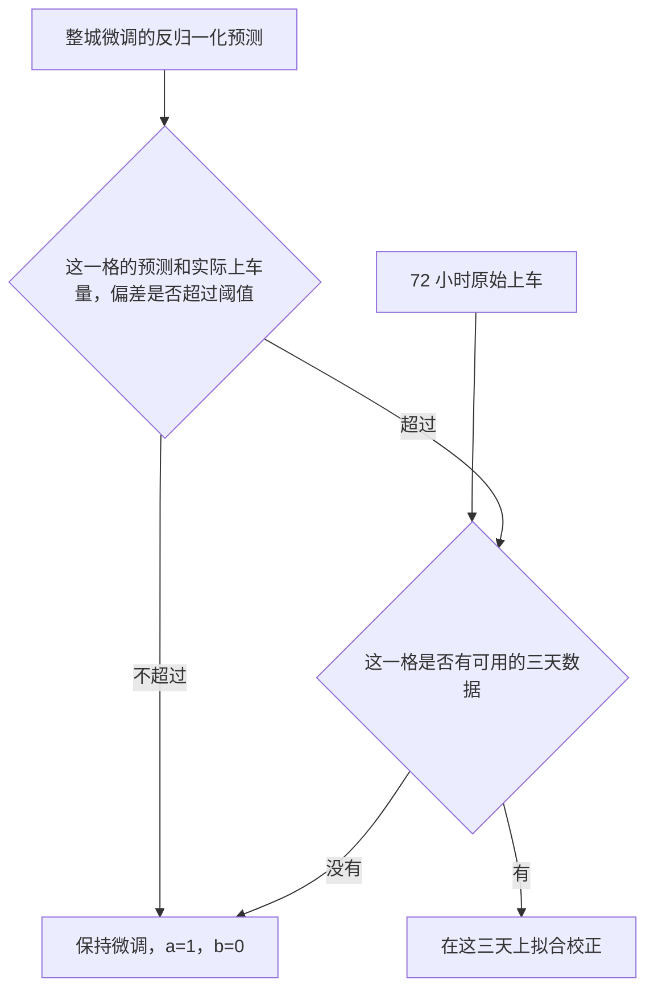

# Advisor meeting: per-cell formula and error feedback

## Agent brief

Read this section before editing code, slides, or result tables. The Chinese sections below are the meeting record. They are a reconstruction, not a transcript, and they do not authorize new metrics.

Written against `main` at `3bea486` (2026-11-18). Formula source of truth: `solve_centered` in `scripts/19_cell_affine_v2.py`, and [CELL_AFFINE_V2_PLAN.md](../CELL_AFFINE_V2_PLAN.md) §1.3. Cite only numbers already in the repo.

The advisor was looking at the post-finetune per-cell correction, not a new ST-Net. Today a Washington cell is corrected only when its 72-hour raw pickup sum is at least 150. That gate passes 50 cells. The other 157 stay at `a=1`, `b=0`. The line is fit on those 72 training hours. Validation and test do not enter the fit. After the fit, later error does not change `a` or `b`. The advisor called this open-loop: the gate sees volume, not how far the prediction missed, so the correction cannot pull itself back.

Do both items below. Formula page first, then the feedback gate. Do not start the feedback test table before the formula page exists.

### 1. One page that can be derived out loud

Symbols must match `solve_centered`. Units are denormalized pickups.

| Symbol | Meaning in code |
|---|---|
| `n` | hours in the fit. Final fit uses `n=72` |
| `p_t` | finetuned, denormalized prediction |
| `y_t` | actual pickups in that hour |
| `p̄` | `pred.mean()`. Transcript "P" / "μ" / "P8" |
| `p_{c,t}` | `pred - center`. Sums to 0 |
| `r_t` | `truth - pred` |
| `S` | `centered @ centered` |
| `CV²` | `S / (n p̄²)`. Median on gated cells is about 0.46 to 0.69. This is not `R²` |
| `κ` | penalty. `0` is OLS. `+∞` returns `(a, b) = (1, 0)` |
| `ã` | local name `deviation` |
| `c` | local name `level` |
| `a`, `b` | the returned pair: `1 + deviation`, `level - deviation * center` |

Closed forms already implemented:

```text
ã = (p_c · r) / (S + κ n p̄²)
c = (sum r_t) / (n (1 + κ))
a = 1 + ã
b = c - ã p̄
p'_t = a p_t + b = p_t + ã (p_t - p̄) + c
```

`p̄` is computed on the fit hours only. Do not recompute it on validation or test. `apply_affine` is `p * a + b`.

The page must also say:

1. Why the objective uses a sum of squares. Signed absolute errors cancel, so they do not measure how far the cell is off. Squares do not cancel.
2. `sum p_c = 0` is why slope and level have separate normal equations. State that orthogonality. Do not treat it as proof of the withdrawn `R²` identity below.
3. `R²`, if it appears, is only the ordinary definition `1 - Σ(y − ŷ)² / Σ(y − ȳ)²`. The advisor used this to pin the spoken claim that 0 means no improvement over predicting the mean and 1 means the squared error is fully accounted for. It is a definition, not an equality that was finished on the slide.
4. What happens to `c`. `c` is proportional to `sum r_t`. If that sum is 0, the level does not move, so `c` is not an anti-overfitting vertical shift. Pick one and write it into the objective. The meeting did not choose:
   - keep `c`, and say it moves the level only when the mean residual is nonzero;
   - replace `c` with a linear-trend bias, and write the regression plus the squared objective it minimizes.
5. Every division has a named numerator, denominator, and unit. Drop a term that cannot be named.

Done when `ã` and `c` can be derived from the objective without the script, and the withdrawn identity below can be pointed at. This page carries no new test MAE.

Withdrawn, until someone can derive the right-hand side line by line:

- The slide that divides numerator and denominator by `n²` and concludes the expression equals an OLS `R²` built from `CV²` and `κ`. Walking the division, the denominator can become `CV²`, and the numerator does not become that `R²`. As written, the quantity collapses to 1, or to a bare `R` with no index.
- Calling the correction a "shape term" plus a "level term" that separate because a sum is 0, without mapping those words onto `ã` and `c`.
- Any leftover "divide the residual by something." The transcript sounded like "negative binomial." The student did not identify the term. Leave it out.

### 2. Error feedback in front of the 150 gate

Add one decision before the existing per-cell fit. Still correct only cells that pass, and leave every other cell at `a=1`, `b=0`.

- The gap uses this cell's prediction and its actual pickups on the same 72 hours. The meeting required the gap to exceed a threshold fixed in advance. It did not choose MAE versus another distance. Write that choice into the protocol before fitting.
- A cell without the three days of data is not corrected.
- Select the threshold on the training window or the validation set. Never on the test set.
- Keep 150 as the current open-loop rule and write it next to the new decision. Do not change 150, and do not reuse the 2026-11-05 Pearson examples 0.5 and 0.8 as this threshold.
- "About 100 vehicles versus about 80" was an order-of-magnitude example, not a measured cell.
- Transcript wording "50 days", "functional", and the garbled follow-on refer to this existing 150 gate and the fit after it. Do not add a network module. The meeting did not ask to change 150.

Done when the flowchart shows an actual-pickup check before the fit, and a cell that fails the check is numerically identical to the finetuned prediction. Do not treat a test table for this rule as a conclusion before the formula page is done.

### Do not

- Retrain ST-Net, reopen Group 3's Pearson multiplier, or reopen the 2026-11-05 routing thresholds. Those still live in [2026-11-05-meeting.md](2026-11-05-meeting.md).
- Claim the centered formula, validation-selected `κ`, or the dual-`κ` pilot is better. Those write-ups stay as records. The advisor said the result page cannot be judged while the formula page does not parse, so change the explanation before changing the tables.
- Add a finding that the open-loop correction diverges. Divergence was the reason to add feedback, not a result already in the repo.
- Use the transcript export time, 2026-11-21 16:55, as the meeting date. The student said the meeting was the week before. The transcript has no separate date.

## 导师会议记录

> 会后整理，不是逐字稿。材料是「录音 7」的转写，文件导出时间是 2026-11-21 16:55。学生说明这是上周和导师的讨论。转写里没有单独的开会日期，本文不把导出日写成开会日。
>
> 听写有大量错词。下面的符号按仓库里已经写定的按格校正还原。还原不了的句子放在最后一节，不写成新要求。本文不新增实验结果，也不改任何已有指标。

对照的仓库状态是 `main` 上的 `3bea4868`（2026-11-18，中心化按格仿射、val-select-kappa、dual-kappa 都已合并）。公式以 `scripts/19_cell_affine_v2.py` 的 `solve_centered` 和 [CELL_AFFINE_V2_PLAN.md](../CELL_AFFINE_V2_PLAN.md) 第 1.3 节为准。数字只引用已入库文档。

## 1. 会上在看哪一条管线

导师看的是微调之后的按格校正，不是重新训练 ST-Net。

当前仓库里，一个华盛顿格子要不要校正，只看 72 小时原始上车合计是否不少于 150。过门 50 格，其余 157 格保持 \(a=1\)、\(b=0\)。过门之后在这 72 小时上解一条直线，验证集和测试集不参加拟合。拟合结束就交卷，后面的误差不再回来改 \(a,b\)。

转写里的「满 50 天就去做 functional」按这条规则理解：150 和「50」在听写里容易混在一起，过门格数也正好是 50。「functional」听不清，不把它写成新的网络模块。会上没有要求改掉 150 这个数。

导师用的例子是数量级说明，不是某一格的实测：源城那边按迁移得到的量大约是 100 辆，目标城同一格实际大约是 80 辆。偏差大过事先定下的阈值时，说明这一格搬过来的规律本身不可靠，应当再用目标城的数据做一次校正。格子如果已经有这三天的量，就做；没有，就不要硬做，先留在原来的预测上。

导师把现在的做法称为开环：门槛只看数据量，校正完不再看预测偏了多少。开环收不到误差，从控制上看有超调、最后发散的风险。这句话是加反馈的理由。仓库里还没有一条「校正后误差变大所以发散」的实验结论，本文也不补这种结论。

闭环要加在现有流程图最左边、进入按格拟合之前：用这一格的实际上车量回看预测。偏差超过阈值，并且三天数据够，才拟合；否则保持微调原样。



阈值的具体数字会上没有给。0.5、0.8 是 11 月 5 日会议里 Pearson 分档的例子，不是这次的误差阈值。不要把 150 门直接当成这个新阈值。新阈值只能在训练窗或验证集上定，不能看测试集。

## 2. 仓库里已经写下的公式

对一个过门格，\(p_t\) 是微调反归一化后的预测上车量，\(y_t\) 是该小时的实际上车量，\(n\) 是参加拟合的小时数，最终拟合时 \(n=72\)。

\[
\bar p=\frac1n\sum_t p_t,\qquad
p_{c,t}=p_t-\bar p,\qquad
r_t=y_t-p_t,\qquad
S=\sum_t p_{c,t}^2.
\]

\(\bar p\) 是这 \(n\) 小时预测的均值。转写里的「P 是均值」「P8 / 密」都是这个 \(\bar p\)，也就是导师口头说的 \(\mu\)。\(p_{c,t}\) 是预测减去自己的均值，转写里的 PC。它的和是 0，所以高于均值和低于均值的部分会互相抵消。\(r_t\) 是未校正预测和标签的差。\(S\) 是中心化预测的平方和。

\[
\mathrm{CV}^2=\frac{S}{n\bar p^2}.
\]

这是预测起伏相对水平的大小。过门格上它的中位数大约在 0.46 到 0.69，见 [cell_affine_v2.md](../profiles/cell_affine_v2.md)。它本身不是 \(R^2\)。

带惩罚的目标是

\[
J(\tilde a,c)=\sum_t\left(r_t-\tilde a\,p_{c,t}-c\right)^2+\kappa n\bar p^2\tilde a^2+\kappa n c^2.
\]

因为 \(\sum_t p_{c,t}=0\)，中心化预测和常数向量正交，斜率和水平的正规方程分开，闭式解是

\[
\tilde a=\frac{\sum_t p_{c,t} r_t}{S+\kappa n\bar p^2},\qquad
c=\frac{\sum_t r_t}{n(1+\kappa)},\qquad
a=1+\tilde a,\qquad
b=c-\tilde a\,\bar p.
\]

用的时候

\[
p'_t=p_t+\tilde a(p_t-\bar p)+c.
\]

\(\bar p\) 只用拟合小时计算，验证和测试不重算。\(\kappa=0\) 是不惩罚的最小二乘，\(\kappa\to\infty\) 退回 \((a,b)=(1,0)\)。代码在 `solve_centered`：`deviation` 是 \(\tilde a\)，`level` 是 \(c\)，返回的是 \(a\) 和 \(b\)。

旧公式仍是对照，不是这页要解释的主式：

\[
J_O(a,b)=\sum_t(y_t-ap_t-b)^2+\lambda(a-1)^2+\lambda b^2,\qquad \lambda=72
\]

在已发表的种子 42 上，旧公式测试 MAE 是纽约 1.7054、芝加哥 1.4415，相对一律微调低 0.58% 和 2.42%。11 月 17 日、18 日又入库了三份后续记录，转写没有逐项讨论它们：中心化公式 \(\kappa=1\) 相对 \(\lambda=72\) 的主比较是测试 MAE 更高，六个源城乘种子方向一致；用验证集选 \(\kappa\) 没有在测试集上胜过各自的默认强度；两个 \(\kappa\) 的试点按预锁规则是 STOP。这些表留在原处。导师当时指着公式后面的结果页说，前面讲不清，结果就无法判断对错。所以这些数字继续只作已跑记录，不拿来宣称新公式更好，也不为了这次会议再扩网格、换损失或重训。

## 3. 导师认为可以说的部分

平方误差可以保留，而且应当讲清楚为什么不用绝对误差。绝对偏差正负相消，量不出这一格到底偏了多少。平方之后，偏差不会被抵消。

\(S\) 和 \(\mathrm{CV}^2\) 可以讲成相对「只预测均值」的改进。导师的说法是：这个量是 \(R^2\)，0 表示没有提高，1 表示平方误差被解释完。写成定义就是

\[
R^2=1-\frac{\sum_t(y_t-\hat y_t)^2}{\sum_t(y_t-\bar y)^2}.
\]

这是为了把口头说的改进比例固定下来，不是会上那一页已经推完的等式。第 4 节那条同除 \(n^2\) 之后的写法仍然撤下。

中心化之后斜率和水平可以分开解，这一点代码里已经成立，原因就是 \(\sum p_c=0\)。可以讲的是这一句正交。不要把正交直接说成「所以某一页上的 \(R^2\) 等式成立」。

## 4. 导师认为说不通、必须改的部分

会上有一页把分子分母同除 \(n^2\)，想得到「分母是 \(\mathrm{CV}^2\) 再加一个 \(\kappa\)，于是整个式子等于 OLS 的 \(R^2\)」。导师把除法走了一遍：分母里的 \(S\) 按定义可以收成 \(\mathrm{CV}^2\)，分子收不成那一页写下的 \(R^2\)。照那一页的写法，这个量会变成 1，或者变成一个没有下标、又不等于求和项的 \(R\)。学生当时不能从等号左边推到右边。

这条等式从方法里撤下。在能够逐行从目标函数推到右端之前，不要写「\(R^2_{\mathrm{OLS}}\) 等于 \(\mathrm{CV}^2\) 和 \(\kappa\) 的某个组合」。\(R\) 如果还出现，必须有下标，并且写明是哪一项的和。

另一页把校正拆成「形状项」和「水平项」，并写「因为和为 0，两项互不牵扯，可以分解」。导师问形状项在方法的哪一步。学生的口头解释是：没有惩罚时，用起伏去拟合残差，得到形状；后一项再对这个形状做缩放。这个解释没有对应到上面的 \(\tilde a\) 或 \(c\)，两项为何相等也没有推导。在重写完成之前，不把「形状项 / 水平项可分解」当作方法陈述。

\(c\) 也被讲成：把整条预测曲线上下平移，用来减轻过拟合。导师指出这一项说不通。\(c\) 正比于残差之和 \(\sum_t r_t\)。这个和可以为 0，平移就不会发生，起不到「整体往上或往下挪一截」的作用。若目的只是预测的整体偏差，用一条线性回归的趋势当 bias，比单独留这个 \(c\) 更直接。会上没有选定保留 \(c\) 还是改成趋势项。重写时二选一，并写进目标函数：

- 保留 \(c\)：写明它只在平均残差不为 0 时移动水平，并不自动防止过拟合。
- 改成趋势：给出回归式和要最小化的平方和，说明趋势怎样进入 \(p'\)。

转写后段还有一个「残差再除以某一项」。听写像「负二项」，学生没有解释那一项是什么，并说回去再看。这一项不进入方法。公式里每一个除法都要能当场说出分子、分母和单位。

导师明确说：这一页解释不通，后面的结果就无法判断对错；结果那一页先不必看。所以本周先改解释，不先改表。

## 5. 本周要做的两件事

两件事都做。顺序是先公式，再加阈值。公式是把已有式子讲明白，导师说理论上不用算很多。阈值加在现在的流程上，不换骨干，不重开 Group 3 的 Pearson 乘子。

### 第一件：把公式写成能当场讲的一页

一页纸，符号和 `solve_centered` 对齐，包含：

1. \(n,\ p_t,\ y_t,\ \bar p,\ p_{c,t},\ r_t,\ S,\ \mathrm{CV}^2,\ \kappa,\ \tilde a,\ c,\ a,\ b\) 各是什么，单位是反归一化上车量。
2. 为什么用平方和，而不是绝对误差。
3. \(\sum p_c=0\) 怎样让斜率和水平分开。只写第 2 节那两行闭式解。
4. 第 3 节那个定义清楚的 \(R^2\)。删掉同除 \(n^2\) 之后等于 OLS \(R^2\) 的那条未推导等式。
5. \(c\) 的去留。保留或改成线性趋势，二者都要有目标函数。不把 \(c\) 写成「防过拟合的上下平移」。
6. 每个除法的分母叫什么。解释不了的项删掉。

做完的标准：不看稿，能从目标函数推到 \(\tilde a\) 和 \(c\)，并指出哪一条旧幻灯片等式已经撤下。这一页不附带新的测试 MAE。

### 第二件：在 150 门之前加误差反馈

在现有按格流程最前面加第 1 节的判断，仍然只校正过了判断的格子，其余格子 \(a=1\)、\(b=0\)。

- 偏差用这一格、这 72 小时上的预测和实际上车量计算。具体用绝对误差的均值还是别的距离，写进协议再拟合。会上只要求「大过一个事先给定的阈值」。
- 三天数据不够的格子不做校正。
- 阈值不在测试集上选。
- 150 门先保留为现在的开环规则，和这个新判断并排写清。不要在没写协议之前把 150 改成别的数，也不要把 Pearson 的 0.5 / 0.8 拿来当误差阈值。

做完的标准：流程图上，拟合之前有一个用实际上车量回看的判断；没过这个判断的格子数值上等于微调。在公式那一页写完之前，不把这条新规则的测试表当作结论。

## 6. 听写对不上、不另作要求的句子

| 转写 | 本文怎么处理 |
|---|---|
| 「100 辆 / 80 辆」 | 偏差的例子，不是实测格子 |
| 「满 50 天」「functional」「翻球」 | 指现在的 150 门和随后的按格拟合。不新增模块 |
| 「beta 就是 b，P8 就是密」 | \(\bar p\) 是预测均值；\(b\) 仍是旧式或还原后的截距 |
| 「G 是 last」「AQ / ORS」 | 按 \(R^2\) 和 OLS 理解。听不清的缩写不单列成新符号 |
| 「负二项」 | 一个没解释的分母。删除，直到能指出是哪一项 |
| 「下一页的结果」 | 指公式页后面的指标。仓库里已有的表保留为记录，不在这次会议里重新解释 |

11 月 5 日会议里的 Pearson 分档、兴趣点功能标定、六个城市方向，这次没有重开。那些事项仍以 [2026-11-05-meeting.md](2026-11-05-meeting.md) 为准。
