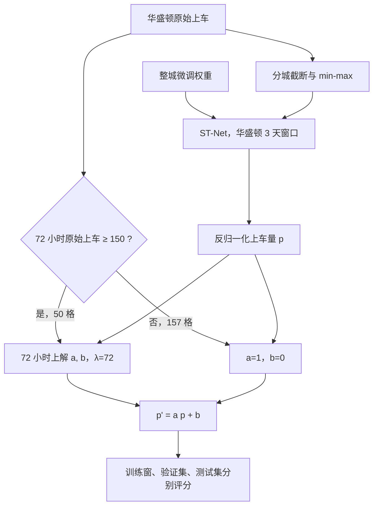

# 按格仿射：A、B 怎么来，λ 在公式里是什么

日期：2026-11-16。这一页只解释 [cell_affine.md](cell_affine.md) 和 `scripts/17_cell_affine.py`。它是 PR #18 前半的按格校正。形状混合的权重 \(w\)、蒸馏损失里的 λ，都是别的量，放在最后一节，避免和这里的 λ=72 混在一起。

当前工作区没有 `checkpoints/finetune_ny2dc.pt`、`checkpoints/finetune_chi2dc.pt` 和 `data/processed/`。逐格 \(a,b\) 和不同 λ 的对比没有重跑。下面的分位数和 MAE 都是已提交文档里的数。

## 整条流程

没有新训练。起点是种子 42 已经训好的整城微调：纽约用 `finetune_ny2dc.pt`，芝加哥用 `finetune_chi2dc.pt`。

1. 华盛顿数据仍按训练时的方式读取：原始上车，有效格是时间和为正的格子，共 207 个；分城 99.9 分位截断和 min-max；3 天窗口是标签小时 `[5832, 5904)`。
2. 微调网络吃归一化后的过去 6 小时，sigmoid 输出在有效格上。反归一化是 `预测 × (上限 − 下限) + 下限`。校正用的 \(p\) 和标签 \(y\) 都是这个上车量。
3. 门槛用原始计数：这 72 小时上车合计不少于 150 的格子才拟合，文档里是 50 个。其余 157 个格子固定 \(a=1\)、\(b=0\)，预测保持微调原样。原始门槛和模型标签门槛不一致的格子是 0 个。
4. 每个过门格子只用这 72 个训练小时拟合 \(p' = a p + b\)。验证集和测试集不参与拟合，只用来报告。
5. \(a,b\) 由下面的岭回归解出。λ 事先定为 72，等于小时数。拟合之后没有把 \(a\) 裁到任何区间，也没有把预测裁成非负。

## A 和 B 的公式

对一个过门格子，记 72 个小时的微调预测为 \(p_t\)，真实上车为 \(y_t\)，\(n=72\)，\(\lambda=72\)。要最小化的是

\[
J(a,b)=\sum_{t=1}^{n}(y_t-ap_t-b)^2+\lambda(a-1)^2+\lambda b^2.
\]

第一项是这 72 小时的残差平方和。第二项把 \(a\) 拉向 1、把 \(b\) 拉向 0，也就是拉向「不校正」。λ 在看验证集和测试集之前定为小时数，之后没有改，也没有在验证集上搜索。

对 \(a\)、\(b\) 求导并令其为 0，得到脚本 `solve_ab` 里的线性方程。记 \(p\cdot p=\sum_t p_t^2\)，\(p\cdot y=\sum_t p_t y_t\)：

\[
\begin{aligned}
(p\cdot p+\lambda)\,a+\Big(\sum_t p_t\Big)\,b&=p\cdot y+\lambda,\\
\Big(\sum_t p_t\Big)\,a+(n+\lambda)\,b&=\sum_t y_t.
\end{aligned}
\]

右边第一行的 \(+\lambda\) 来自 \((a-1)^2\) 的中心在 1。\(b\) 的中心在 0，所以第二行右边没有额外的 λ。脚本用 `numpy.linalg.solve` 解这个 2×2 矩阵，把解直接写回该格。没有 `clip`，没有投影到 \([0,1]\)。

因此 **\(a\) 没有被限制在 0 到 1**。\(a\) 是预测的乘数，可以大于 1，也可以小于 1。它不是混合权重。已提交的过门格子汇总：

| 源城 | \(a\) 中位数 | \(a\) 的 10 到 90 分位 | \(b\) 中位数 | \(b\) 的 10 到 90 分位 |
|---|---:|---|---:|---|
| 纽约 | 0.9890 | 0.8381 到 1.2092 | 0.1994 | −0.2947 到 0.5732 |
| 芝加哥 | 0.9390 | 0.7974 到 1.1403 | 0.6107 | 0.0373 到 1.2474 |

纽约有格子的 \(a\) 到约 1.21，芝加哥到约 1.14。这和「没有裁到 \([0,1]\)」一致。

## λ 这一项是什么意思

它是 72 个点、两个自由参数时的稳定项。样本只有三天，\(p_t\) 如果在这 72 小时里变化不大，\(a\) 和 \(b\) 会互相补偿，普通最小二乘可以把噪声拟进一条很陡的直线。\(\lambda(a-1)^2+\lambda b^2\) 的作用是：数据没有明显要求离开恒等映射时，留在微调原来的预测附近。

它不是第二个数据集，也不是蒸馏。蒸馏的 λ 乘的是学生和教师输出的差距。这里的 λ 乘的是「校正量离开 \((1,0)\)」的平方。

λ=72 的来历是「等于训练小时数」。这个选法在特征大约是 1 的时候比较自然，例如预测还在归一化区间里，或滞后特征已经标准化。本实验的 \(p\) 和 \(y\) 是反归一化后的上车量，过门格子的量级是每小时数次到数十次上车。此时两项的大小不一定匹配，导师指出后一项可能远弱于前一项，这个判断和公式是对齐的。

把曲率分开看：

- 数据项对 \(a\) 的曲率正比于 \(p\cdot p\)。惩罚项对 \(a\) 的曲率正比于 λ。两者之比是 \(\lambda/(p\cdot p)\)。
- 若这 72 小时的预测大致停在水平 \(m\) 附近，则 \(p\cdot p\approx n m^2\)，而 λ=\(n\)，于是 \(\lambda/(p\cdot p)\approx 1/m^2\)。
- 过门条件是 72 小时合计不少于 150，平均每小时不少于 \(150/72\approx 2.08\)。即便序列是平的、刚好卡在门槛上，\(1/m^2\) 也只有约 0.23。平均每小时 10 次上车时，这个比大约是 0.01。忙的格子上，把 \(a\) 拉回 1 的力量只占最小二乘曲率的一小部分。
- 数据项对 \(b\) 的曲率正比于 \(n=72\)，惩罚项正比于 λ=72，两者同阶。截距这一维的拉动比斜率这一维更明显。

上面的 \(1/m^2\) 是量级说明，不是从逐格 \(p\) 算出来的 \(p\cdot p\)。逐格能量不在 JSON 里。它要说明的是：不能凭「λ 已经等于 72」认为正则很强。λ 的单位还和两项对不齐。残差平方和与 \(b^2\) 的单位是上车量的平方，\((a-1)^2\) 没有单位。同一个 λ 加在这两项上，没有把它们变成可以互相比较的权重。

已有的 \(a\) 分布和这个量级一致：中位数离 1 不远，10 到 90 分位却铺到大约 0.80–1.21，说明惩罚没有把 \(a\) 钉在 1 上。惩罚仍然可能削掉更极端的最小二乘解。要知道 λ=72 和 λ=0 差多少，需要用同一批预测重解 λ=0、λ=72，以及和 \(p\cdot p\) 同阶的更大 λ。这次没有权重和数据，没有做这个对比。若以后做，λ=72 的现有 MAE 保留为对照，新 λ 单独记。

## 现有误差说明校正幅度不大

相对的是同一条微调，不是从零训练。种子 42，全城、反归一化上车量：

| 源城 | 划分 | 一律微调 MAE | 按格 \(a,b\) MAE | 相对微调 |
|---|---|---:|---:|---:|
| 纽约 | 72 小时训练窗 | 1.5085 | 1.4845 | +1.59% |
| 纽约 | 验证集 | 2.0548 | 2.0360 | +0.91% |
| 纽约 | 测试集 | 1.7153 | 1.7054 | +0.58% |
| 芝加哥 | 72 小时训练窗 | 1.4824 | 1.4104 | +4.86% |
| 芝加哥 | 验证集 | 1.7130 | 1.6863 | +1.56% |
| 芝加哥 | 测试集 | 1.4773 | 1.4415 | +2.42% |

训练窗上的下降大于测试集，符合 \(a,b\) 只在这 72 小时上拟合。测试集上纽约再低 0.58%，芝加哥再低 2.42%。157 个没过门的格子两行 MAE 相同，因为它们的 \(a,b\) 就是 1 和 0。这是微调之上的小幅校正，不是另一套迁移方法。

相对华盛顿 3 天从零训的测试 MAE 1.8701，纽约按格结果低 8.81%，芝加哥低 22.92%。其中大部分已经由微调贡献，见 [PAPER_COMPARISON.md](../PAPER_COMPARISON.md)。

## 三个容易混的系数

| 名字 | 出现的地方 | 作用 | 怎么取值 |
|---|---|---|---|
| 这里的 λ=72 | `17_cell_affine.py` 的 \(J(a,b)\) | 把过门格的 \(a,b\) 拉向 1 和 0 | 等于 72 个训练小时，事先固定 |
| 蒸馏的 λ | `L_task + λ L_kd`，见 RESULTS | 学生靠近冻结教师的输出 | 主实验是 1；芝加哥另扫过 0.1、0.5、5 |
| 形状混合的 \(w\) | `18_shape_blend.py`，\((1-w)\times\)微调 \(+ w\times\)形状 | 两条预测的混合权重，\(w\) 在 0 到 1 | 验证集全城 MAE 上从 0 到 1、步长 0.05 |

形状混合的纽约 \(w=0.10\)、芝加哥 \(w=0.15\)。那个 \(w\) 被网格限制在 \([0,1]\)。按格仿射的 \(a\) 没有这一步。
