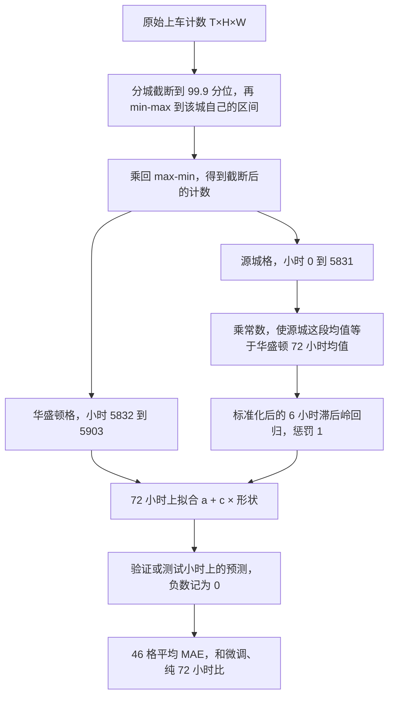

# 匹配源格：归一化做了什么，纽约和芝加哥为什么看起来差很多

日期：2026-11-16。实验定义和汇总数以 [matched_cell.md](matched_cell.md) 与 `scripts/17_matched_cell.py` 为准。归一化以 `src/data/dataset.py` 的 `min_max_normalize` 为准。这一页没有新跑实验。当前工作区没有 `data/processed/` 和微调权重，所以没有逐格残差，也没有重算缩放倍数。

## 实验在做什么

通道是出租车上车。不改整城 ST-Net，也不看邻域。对每个通过筛选的华盛顿格子，找一个源城格子，用那个源城格子的历史小时序列学一个 6 小时滞后的形状，再在华盛顿这 72 个标签小时上把水平对齐，然后去预测后面的小时。

筛选在看验证集之前定死，两条源城分开做：

1. 2016-08-31 至 09-02 的原始上车合计不少于 150。这个合计来自原始计数，来自 `scripts/14_cell_volume.py` 的三天窗。
2. 该格 3 天工作日轮廓与源城某个格子的长期工作日轮廓的 Pearson 最大相关高于 0.8。长期轮廓是训练前缀里 176 个工作日的 24 小时均值，短轮廓是这 3 天的 24 小时均值。相关高于 0.8 的华盛顿格子，纽约源和芝加哥源都是 46 个；用到的不同源城格子分别是 25 个和 26 个。两套 46 格是各自筛出来的，汇总 JSON 没有格子编号，不能写成「同一批 46 格」。

通过筛选之后，时间序列模型用的是小时计数，不是那条 24 小时轮廓：

1. `_clipped` 把原始数组做一次分城 99.9 分位截断和 min-max，再乘回去，得到截断后的计数。
2. 源城序列只取下标 `[0, 5832)`。乘上一个常数，使这段的均值等于华盛顿该格在 `[5832, 5904)` 上的均值。
3. 在缩放后的源城序列上，用 6 个滞后小时做岭回归。特征先标准化，惩罚系数固定为 1，不在验证集上选。
4. 把学到的形状用到华盛顿序列上。在 72 个标签小时上再拟合 `a + c * 形状预测`，预测小于 0 的记为 0。
5. 对照有两个，都在这 46 格上算平均 MAE：已经训好的整城微调，以及只用这 72 小时、不用源城格子的岭回归。验证集 MAE 严格低于整城微调，才打开测试集。

## 归一化实际做在哪

训练 ST-Net 时，`prepare_city_windows` 对一整座城调用一次 `min_max_normalize`：

- 把该城 `T×H×W` 的全部数值排序，取下标 `int(长度 × 0.999)` 作为截断上限。
- 下限是 `max(0, 最小值)`。上车计数的下限就是 0。
- 大于上限的值截断到上限，然后减去下限，再除以上限减下限。
- 纽约、芝加哥、华盛顿走的是同一个函数。统计量各用各的城，因为输入数组不同。

[RESULTS.md](../RESULTS.md) 记录的截断上限大约是纽约 1212、芝加哥 536、华盛顿 234。模型在这一城自己的区间里训练，输出经过 sigmoid，评估时再乘回 `(上限 - 下限)` 并加上下限，回到截断后的上车量。

因此「做过归一化」指的是：每座城各自进过自己的 `[0, 1]` 附近。它没有把纽约和芝加哥放进同一个尺度。归一化值 0.5 在下限为 0 时，对应纽约大约 606、芝加哥大约 268、华盛顿大约 117，单位仍是每小时上车量。三座城的 0.5 不是同一个物理量。

匹配源格实验没有停在这个区间里。`_clipped` 把 min-max 乘了回去。后面的岭回归、均值缩放和 MAE 都在截断后的计数上。缩放倍数的中位数是纽约 **0.2621**、芝加哥 **0.6298**。倒数大约是 3.82 和 1.59：匹配上的纽约格子，在 `[0, 5832)` 上的均值大约是华盛顿该格 3 天均值的 3.82 倍；芝加哥大约是 1.59 倍。这两个倍数是格子级均值之比的中位数，和全城截断上限 1212 / 536 / 234 不是同一个数，方向一致：纽约的计数尺度离华盛顿更远。

纽约和芝加哥的处理步骤相同。差距来自计数本身，以及下面两条不同的微调基线。

## 为什么「已经归一化就不该差这么多」和实现不符

这个判断要成立，比较需要发生在一个共享的归一化空间里。实现里的比较发生在均值对齐之后的华盛顿计数上，而且纽约、芝加哥各跟自己的微调比。

已有的验证集平均 MAE，46 格：

| 源城 | 缩放倍数中位数 | 整城微调 | 匹配源格 | 只用 72 小时 | 低于微调的格子 | 测试集 |
|---|---:|---:|---:|---:|---:|---|
| 纽约 | 0.2621 | 6.8981 | 6.4362 | 6.4334 | 29 | 已打开 |
| 芝加哥 | 0.6298 | 6.2626 | 6.5973 | 6.4442 | 20 | 未计算 |

把「匹配源格」这一列单独看，纽约 6.4362，芝加哥 6.5973，相差 0.1611，大约是 6.4362 的 2.5%。均值对齐之后，两个源城的匹配模型在各自的 46 格上差不多。

看起来差很多的是它们和微调的关系：

- 纽约验证集上，匹配 6.4362 低于微调 6.8981，相对微调大约低 6.70%，所以测试集被打开。同一行里，只用 72 小时是 6.4334，匹配并没有更低。
- 芝加哥验证集上，匹配 6.5973 高于微调 6.2626，大约高 5.34%，也高于只用 72 小时的 6.4442。规则要求严格更低才打开测试集，所以芝加哥测试集没有数。

两套微调本身就差 6.8981 − 6.2626 = 0.6355。这个差距大于两个匹配模型之间的 0.1611。纽约微调来自纽约教师初始化，芝加哥微调来自芝加哥教师初始化，不是同一个华盛顿模型。46 格又是按各自的相关筛的。所以「纽约匹配看起来能打过微调、芝加哥打不过」主要是基线不同、入选格子也可能不同，再加上一条严格的开关。它不是「同一个归一化空间里，同一个模型在两座源城上突然差出一截」。

纽约测试集（只因为验证集过了线才有）：匹配 5.9586，微调 5.7476，只用 72 小时 6.0064。微调仍然最低。匹配相对 72 小时大约低 0.80%，相对微调大约高 3.67%。验证集上的那一点优势没有留在测试集上。

## 现有数字能说明什么

匹配源格没有稳定好于整城微调，也没有稳定好于只用这 72 小时。纽约验证集上它略低于微调、与 72 小时几乎相同；测试集上微调更好。芝加哥验证集上它高于微调和 72 小时，测试集按事先定下的规则没有计算。

缩放倍数 0.26 和 0.63 差一倍以上，和「两座城都做过 min-max」不矛盾：min-max 是分城的，这个实验又回到了计数，再用一个格子级常数把均值对齐。对齐之后比的是形状和 72 小时上的第二条直线，MAE 用华盛顿的上车量。全城训练 MAE 在 1.5 附近，这里的 6 点几是高流量 46 格上的平均，两套数也不能横比。

逐格误差、逐格缩放、两套 46 格的交集，要等本机 `data/processed/`、两个微调权重，以及 `logs/bin_route_cache/` 里的 `{ny,chi}_finetune_{val,test}.npz` 齐了，再跑 `scripts/17_matched_cell.py`。那些量现在不在 JSON 里，这一页不补。
